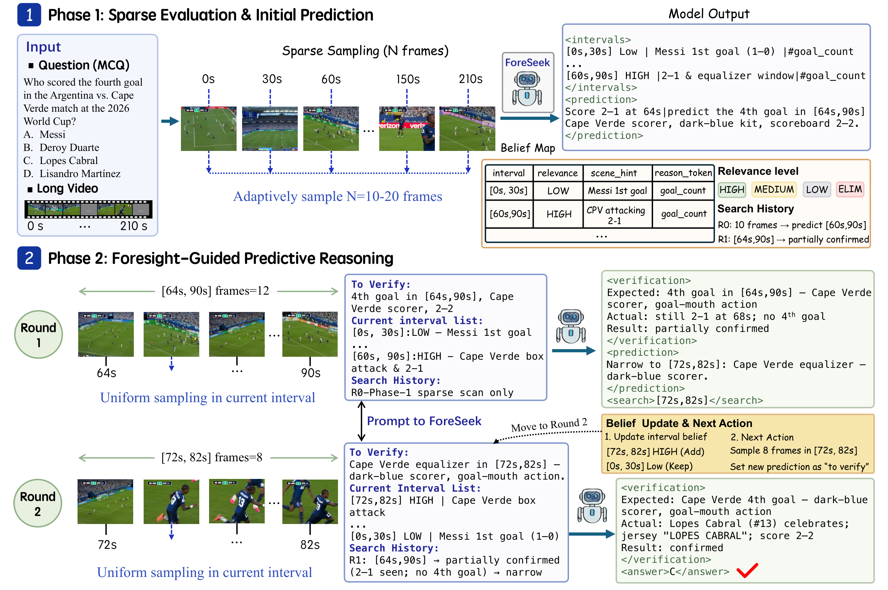

# ForeSeek: Foresight-Driven Evidence Seeking for Long-Video Reasoning

ForeSeek is a video agent that searches a long video by predicting what unseen intervals should contain, then checking those predictions. A failed expectation is kept as evidence: the implausible interval is set aside and the search moves to another region of the timeline.

Paper: [arxiv.org/pdf/2611.26024](https://arxiv.org/pdf/2611.26024).

<p align="center">
  
</p>

## Method

ForeSeek keeps a predictive state: a global interval belief, an expectation for the interval under inspection, and the reasoning trace so far. Each interval carries a relevance label in {High, Medium, Low, Elim}.

**Phase 1.** A short sparse scan covers the whole video. From those frames and the question, the model writes the initial belief and the first expectation.

**Phase 2.** Each later step reads frames inside the current interval and returns one verdict:

| Verdict | What happens next |
|---|---|
| Confirmed | The expectation is supported, and the agent may answer. |
| Partially confirmed | The expectation is refined on a narrower sub-interval. |
| Not found | The current interval is deprioritized and the search moves elsewhere. |

## Checkpoints and data

8B weights: [huggingface.co/Harry0021/ForeSeek](https://huggingface.co/Harry0021/ForeSeek), in the `foreseek-8b` folder.

Training data: [huggingface.co/datasets/Harry0021/ForeSeek-Data](https://huggingface.co/datasets/Harry0021/ForeSeek-Data). SFT trajectories are in `sft/sft_merged_all_v3.jsonl` (32,101 rows, 8,165 questions). The filtered RL set is `rl/train_select.parquet` (4,663 questions).

This repository contains the agent, the trajectory builder, and the training launchers.

## Run

Evaluation uses a local vLLM server or any OpenAI-compatible endpoint. Set `DATA_DIR` to the question files and the matching `VIDEO_ROOT*` to the videos.

```bash
PROMPTS_MODULE=prompts_v9k2 AGENT_MODULE=foresight_agent_v9k2 \
LOCAL=1 DATASET=videomme VIDEO_ROOT=/path/to/videos \
bash run_gpu.sh
```

`DATASET` can be `videomme`, `longvideobench`, `lvbench`, `videoholmes`, or `mlvu`.

Trajectories for supervised fine-tuning are built with `cgbench_v9k2_sft_builder-Final.py`. Training is launched with `run_v9k2_gspo_8gpu_1node.sh` on a Ray cluster; pass the checkpoint, data, and video paths through the environment variables at the top of that script. Frame extraction needs `ffmpeg`.
